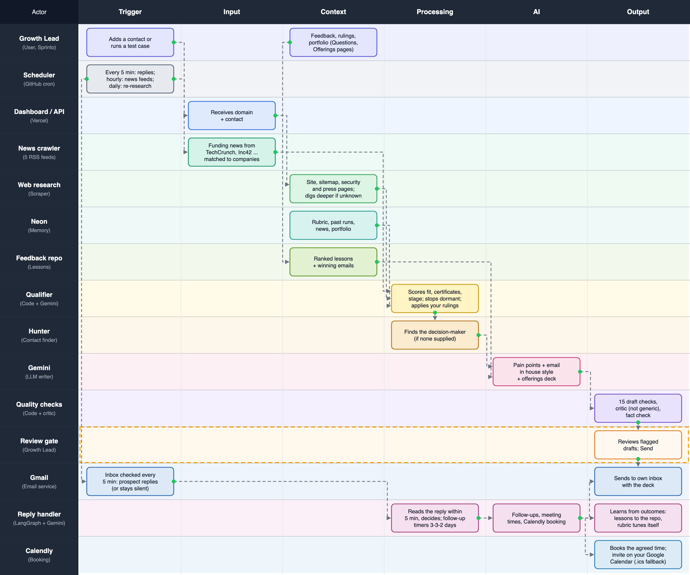

# Sprinto - Cold Outreach, at Scale (MESA T2 · AI Case 2)

## For evaluators: start here



_Component map (`docs/component-map.svg`, regenerate with `python docs/component_map.py`)._

| | Link |
|---|---|
| Run a test case (form) | https://sprinto-cold-outreach-web.vercel.app/test.html |
| Test API | `POST https://sprinto-cold-outreach-web.vercel.app/api/run_case` (`GET` returns the input format) |
| Dashboard | https://sprinto-cold-outreach-web.vercel.app/ |
| Repository | https://github.com/ravibussareddy-stack/sprinto-cold-outreach |
| Demo video | _link added at submission_ |

```bash
curl -s -X POST https://sprinto-cold-outreach-web.vercel.app/api/run_case \
  -H 'content-type: application/json' \
  -d '{"domain": "atlan.com", "contact": {"first_name": "Priya", "last_name": "Sharma", "email": "priya@atlan.com", "title": "CTO"}, "send": false}'
```

**Active qualification policy (the one the deployed app uses):** a company that **itself** holds **SOC 2 or
ISO 27001** is **DORMANT** - no email, re-engaged only if a new certificate appears or a framework you add to the
portfolio fits it. HIPAA or PCI DSS alone stays a prospect (Sprinto adds the core frameworks); GDPR is a regulation
and never counts. Mentions about customers ("we help you get SOC 2") or vendors ("hosted on AWS, SOC 2 audited")
never count, and neither does a "page not found" page. Certification status has three states - *confirmed*,
*in progress*, *unknown* - and greenfield points are given only after a real security or trust page shows no claim.
Companies that were acquired, or already run their audit on another compliance platform, are not prospects. The
other policies on the **Filters & rubric** page are configurable alternatives, not the submission default.
Benchmark on fresh companies: [`BENCHMARK.md`](BENCHMARK.md).

A repeatable 7-step pipeline. Give it a list of domains, and for each one it:

1. **Scrapes** the site (single-fetch, robots.txt respected, cached, Jina Reader fallback for JS-only/blocked pages)
2. **Extracts** a structured company profile with Gemini (named fields + verbatim evidence quotes)
3. **Qualifies** against Sprinto's ICP with an **agent loop**: code checks which facts are missing and fetches the specific page that answers them (max 4 extra fetches)
4. **Finds the PoC**: Hunter.io Domain Search (Option A) or a hard-coded Apollo lookup (Option B)
5. **Identifies two pain points** for that person, each grounded in a researched fact
6. **Drafts a personalised email** by first name with a specific hook, then checks it in code (length, name, CTA, no placeholders) and redrafts once if it fails
7. **Sends via Gmail** to **your own inbox** (hard-coded `SEND_TO`). The intended recipient goes in the footer

Every decision lands in `runs/<timestamp>/report.md` plus one JSON file per company, and in the Neon `runs` table. Scraped pages are cached in Neon for 7 days.

**Stack:** Gemini API (LLM) · Neon Postgres (page cache + run history) · Hunter.io or Apollo (contacts) · Gmail SMTP (send)

## Setup

```bash
pip install -r requirements.txt
cp .env.example .env        # fill in keys
cp poc_overrides.example.json poc_overrides.json   # only if using Apollo (Option B)
python pipeline.py domains.txt            # dry run: research + drafts, no send
python pipeline.py domains.txt --send     # send drafts to your own inbox
python pipeline.py --domain acme.io --send
```

Set `GEMINI_API_KEY` and `NEON_DATABASE_URL` in `.env`. The tables are created on first run.

Gmail needs an **App Password** (Google Account → Security → 2-Step Verification → App passwords).

## "Right companies": the ICP definition

Sprinto sells automated SOC 2 / ISO 27001 / GDPR compliance to SaaS companies. Buyers convert when **(a)** they sell B2B SaaS, **(b)** they're at the stage where enterprise deals start requiring a security report (Series A–C, ~20–500 people), and **(c)** they don't yet have the certification, or have one and need a second framework.

**Short-circuits (stop early)**
- Not B2B SaaS → DISQUALIFIED
- Already holds **any** named certification itself → DORMANT (active policy; see above)
- Public company or >1,000 employees → DISQUALIFIED (in-house GRC team or enterprise GRC tooling)

**Score (0–100, computed in code so every point is explainable)**

| Bucket | Signal | Points |
|---|---|---|
| Stage fit (max 30) | Series A/B/C | 30 |
| | Seed | 15 |
| | Series D+ | 10 |
| | Unknown stage → 20–500 employees / ≥5 open roles | 20 / 15 |
| Compliance pressure (max 50) | Enterprise tier on pricing | 15 |
| | ≥2 named customers | 10 |
| | Enterprise features (SSO/SAML/audit logs/SLA) | 5 |
| | Sensitive data / regulated industries | 10 |
| | Hiring security/compliance roles | 10 |
| | Certification "in progress" | 10 |
| | Recent trigger (funding, expansion, big win) | 5 |
| Certification gap (max 20) | No SOC 2 / ISO claimed **on a security or trust page that was read** | 20 |
| | Status unknown (no security/trust page found) or a compliance tool already in use (Vanta, Drata...) | 0, flagged |
| | Holds one of the two (only reachable under the "SOC 2 + ISO 27001" alternative policy) | 10 |

**≥50 and stage known → QUALIFIED.** 35–49, or stage still unknown after the loop → **QUALIFIED_FLAGGED** (lower rank, review before any real send). <35 → **DISQUALIFIED**. SaaS status unknown → **MANUAL_REVIEW**.

## Evidence map (drives the loop)

| Question | Sufficient when (checked in code) | Where it lives | Limit | If unanswered | Short-circuit |
|---|---|---|---|---|---|
| Already certified? (fetched **first**) | the company's own claim found (each mention attributed to self / customers / vendor, with sentence and URL) or a security/trust page read | /security, /trust, trust.&lt;domain&gt;, footer badges | 1 | **unknown**: no greenfield points, flagged | any named cert → DORMANT |
| B2B SaaS? | `is_b2b_saas` set and buyer named | hero, /about, /product | 1 | manual review | not SaaS → stop |
| Right stage? | funding stage, ≥5 open roles, enterprise tier, or headcount | /careers (incl. Greenhouse/Lever/Ashby), /pricing, /customers | 2 | qualify flagged | Public/huge → stop |
| **Worst case** | 4 fetches beyond the homepage | | | | |

The model fills named fields. Code decides whether it knows enough, so a model that is confident about an empty page can't fool the loop.

## Outreach to meeting (the L5 workflow)

Sequence 1 runs for every prospect. Sequence 2 runs only when the prospect is interested.

| Node | Code |
|---|---|
| Send the cold email | `pipeline.py` step 7 (to your inbox only) |
| Read the reply: interested / not interested / no reply / unclear | `replies.py` (model classifies into fixed intents) |
| check_calendar | `calendar_tool.py` (needs `CALENDAR_BUSY_FILE`; otherwise escalates) |
| send_email with 2-3 times | `meeting.py` |
| Confirms a time: book_meeting (.ics invite) | `meeting.py` |
| Counter-proposes: back to check_calendar, never re-offer a rejected slot | `meeting.py`, capped at `MAX_REPLY_ROUNDS` = 2 |
| Goes silent / unclear / no calendar: hand off to Growth Lead | `meeting.py` |
| update_crm: outcome written to Neon `crm_outcomes` | `crm.py`, `db.py` |

Sequence 2 is a LangGraph (`meeting.py`). The run pauses while it waits for the prospect's reply and the state is checkpointed in SQLite (`CHECKPOINT_DB`, git-ignored). Replies come from `replies/<domain>.txt`, one reply per block, blocks separated by a line `---`. Each block is one turn, in order. Example:

```
Yes, interested. What does this look like?
---
The 3pm one works.
```

Retry table (decided before the build): check_calendar, send_email and update_crm retry transient failures 3 times; book_meeting retries transient failures and aborts on permanent ones; anything that cannot proceed hands off to the Growth Lead. Dry runs (no `--send`) walk the whole flow and write nothing outbound.

Run the offline tests (no keys, no network):

```bash
PYTHONPATH=. python3 tests/test_sequence2.py
```

## Review queue and measurement

Companies that need a human (flagged, manual review, reactivated, escalated, aborted, or errored) are listed by:

```bash
python review.py queue
```

After you review a draft, record it:

```bash
python review.py add acme.io --email kept --poc-correct yes --minutes 1.5
python review.py add acme.io --email rewritten --poc-correct no --minutes 4 --note "wrong CTO"
```

Then check the lecture's targets and kill criteria:

```bash
python review.py metrics
```

Targets: under 2 min per company, fewer than 20% of emails rewritten. Kill: more than 50% rewritten, PoC accuracy under 60%.

## Who is the right person (step 4)

The PoC is whoever **owns getting certified** at that company size:
- **<50 people** → Founder/CEO or CTO (no security team yet; deals stuck in security review hit the CEO)
- **50–200** → Security/compliance lead if one exists, else CTO/VP Eng (engineering loses weeks to evidence collection)
- **>200** → CISO / Head of Security / GRC first, then CTO

Excluded: recruiting, sales, marketing, support, interns. Ties are broken by Hunter confidence. The other candidates are logged.

## Why the email is written this way (step 6)

- Opens on a **true, specific fact** from the research (funding round, enterprise tier, named customer, open security role), not flattery
- Links that fact to the person's #1 pain in one sentence, then gives Sprinto's concrete outcome
- 70–120 words, one question as the CTA, no buzzwords, no invented facts
- Code validates the draft before sending. A failed draft is redrafted once, then held back

## The 9 checks / boundary

The system researches and drafts. It never emails a prospect directly: `To:` is always your inbox. In production, the Growth Lead stays reviewer-and-sender. Kill criteria (from the lecture): Growth Lead rewrites >50% of emails, the system costs more time than it saves, or PoC accuracy drops below 60%.

## Cost

Pages are cleaned and capped at ~1,500 words before reaching the model. Each company costs roughly 3–6 Gemini calls. Cached pages (7 days in Neon) cost nothing on re-runs. Set `GEMINI_MODEL` in `.env` to switch models.

## Quality, learning and the dashboard

- **Quality checks** (`writer.quality_checks`): every draft is checked for structure - time-of-day greeting, "Hope you're doing well", a hook naming the company, exactly one question just before the sign-off, "Kind regards," plus the sender's name, UK spelling, 75-125 words, no placeholders. Results are stored with each run.
- **Disagreement score** (`disagreement.py`, 0-100, report only in build 1): structure (25, from failed quality checks), wrong info (45, unsupported claims about the company *or* about Sprinto) and a sceptical judge (30).
- **Replies** (`check_replies.py`, Gmail mode): positive -> book automatically; negative -> a thank-you email and the contact becomes a *cold lead*; no reply -> up to 3 follow-ups 48h apart, each with a new value proposition and a different ask, then *non-respondent* and no more emails.
- **Feedback repo** (`feedback.py`, Neon `feedback` table): guidance scoped global / role / industry with an outcome score. The writer gets the relevant items ranked best-first and follows the higher-ranked one when two conflict. Add your own with `python feedback.py add "..." --scope role:cto`.
- **Self-reinforcement** (`learn.py`): when a conversation ends, the emails and replies are analysed into lessons scored by outcome (booked 1.0, positive 0.8, negative 0.3, no reply 0.1); emails that earned a positive reply are saved as examples for that role.
- **Dashboard** (`public/`, `api/`, Vercel): engagement rate (any reply / conversations), booking rate (booked / positive replies), pipeline by stage, contacts, emails by type, token use and estimated cost (`GEMINI_PRICE_INPUT_PER_M` / `GEMINI_PRICE_OUTPUT_PER_M`), and the feedback repo.

## Filters and rubric (editable)

Every qualification filter and point value lives in `lib/rubric_defaults.json`. The dashboard's **Filters & rubric** page (`settings.html`) edits them: decision thresholds, company size, the dormant rule (any named certification / only SOC 2 + ISO 27001 / never), which names do not count as certifications, stage and compliance points, the certification gap, evidence-loop fetch limits, and the disagreement score that sends a draft to review. Saved values go to Neon (`settings` table) and apply from the next run; invalid values are rejected with a reason, and `rubric.py` falls back to the default for anything broken. Set `SETTINGS_EDIT_KEY` in Vercel if saving should need a key (viewing never does).

## Test-case API (live on Vercel)

`POST /api/run_case` runs one company through the whole pipeline (scrape -> extract -> qualify with the agent loop -> contact -> two pain points -> personalised email -> send to your own inbox) and returns one JSON result. `GET /api/run_case` returns the input format. The **Run a test case** page (`test.html`) does the same from the dashboard.

```json
{"domain": "atlan.com",
 "contact": {"first_name": "Priya", "last_name": "Sharma", "email": "priya@atlan.com", "title": "CTO"},
 "send": true}
```

- `domain` is required (a URL also works; aliases `website`, `url`, `company_domain`). `contact` is optional (`name` may replace first/last; alias `poc`); without it the pipeline looks the contact up. `send` defaults to true. Several cases: `{"cases": [...]}` (up to 3).
- Response: `status`, `decision`, `qualified`, `company` (fit score, reason, score reasons, flags, pages read, `certification` = status, certificates held, security pages read, attributed evidence sentences with URLs, compliance tools in use), `contact`, `pain_points` (each with the researched evidence and its source URL), `email` (subject, body, addressed_to, hook, sent, sent_to, intended_recipient), `quality` (*draft checks*: structure and style only - facts are checked by the disagreement score in `mode: full`), `disagreement`, `run_id`, `seconds`, `warnings`, `error`.
- Contact fields of the wrong type (e.g. a number for `first_name`) return **400** `invalid_contact` with the field path, e.g. `contact.first_name`.
- Errors: invalid requests return **400** with `error.code` (`empty_body`, `invalid_json`, `missing_domain`, `invalid_domain`, `invalid_contact`, `invalid_send`, `too_many_cases`, ...) and nothing runs; wrong method **405**. Companies that cannot be processed still return **200** with a reason: `site_unreachable`, `no_contact_found`, `draft_failed_checks`, `pipeline_error`, or a `DISQUALIFIED` / `DORMANT` decision. The service never crashes on an input.
- A run takes about 60-80 seconds (`maxDuration` 300s in `vercel.json`). Needs these Vercel env vars: `GEMINI_API_KEY1`(-3), `NEON_DATABASE_URL` (or `DATABASE_URL`), `GMAIL_ADDRESS`, `GMAIL_APP_PASSWORD`, `SEND_TO`, `SENDER_NAME`.

## New certifications and the portfolio

`lib/frameworks.json` lists frameworks introduced recently (ISO/IEC 42001, DORA, NIS2, the EU AI Act, CMMC 2.0), each
with its release date, official source, who needs it and a plain fit rule (keywords in what the company does, plus a
market where the framework applies). Python (`frameworks.py`) and the dashboard (`lib/frameworks.js`) read the same
file. The overview's highlights and to-do say which ones are new, which researched companies already show them, and
which dormant companies each would re-open. **Add to portfolio** saves it (Neon `settings`, key `portfolio`), logs it
in the rubric change log (undoable), and marks every dormant company that fits it **Reactivated**; from then on a
certified company that fits an accepted framework qualifies as an **expansion prospect** (+15, rubric
`certification_gap.new_framework`) and its email pitches that framework. The writer and the fact check are told the
current portfolio, so a claim that Sprinto covers an accepted framework is supported. **Remove** puts the companies it
re-opened back to dormant.

**Offerings page** (`offerings.html`): the portfolio, the suggested certifications, and **Add your own** - a name,
keywords describing who needs it, optional markets and a one-line pitch. **Preview who it fits** checks every researched
company without saving; adding it puts it in the portfolio and re-opens the dormant companies it fits.

## Questions: judgement calls, not missing facts

Missing facts are researched, never asked: when certification is still unknown after the normal pages, the run reads
the site's sitemap and the usual trust, security and privacy pages (`qualify.deep_cert_urls`). A question is raised
only for a situation the rules do not settle - "I found this; how should I read it from now on?" - and your answer
becomes a **standing ruling** for every company (`questions.py`, `/api/questions`, `questions.html`).

| Situation (asked once, examples added) | Default until you rule | The other ruling |
|---|---|---|
| Only a SOC 2 **Type I** report | certified (dormant) | still a prospect for Type II |
| Certificate shown only as a **badge**, no statement | counts | only clear statements count |
| Uses **Vanta / Drata**-type platform, no certificate | switch prospect (flagged) | skip |
| **Acquired** company | skip | prospect |
| **Sells compliance software** itself | prospect | competitor: skip |
| Only an **old report** (2+ years) | still counts | lapsed |

New situations: while reading a site the model may note one `unusual_finding` the rules do not cover (never a missing
fact). It becomes a free-text question; your ruling is applied to later companies with the same finding by a short
model call that can only keep the decision or move it to dormant / disqualified / qualified, quoting your ruling. At
most 5 new situations wait at once. Nothing ever waits on a question: open ones show the default in the company's
flags ("judgement call waiting for you: ..."), on the Questions page (badge in the nav) and as the first to-do.

## Discovery emails, the offerings deck and adding contacts by hand

- **No certification information anywhere** (even after the sitemap and trust pages): instead of holding the company
  back, it gets a **discovery email** that asks whether SOC 2 or ISO 27001 is on their roadmap - it never says or
  implies they lack it (decision `QUALIFIED_FLAGGED`, reason says "discovery email").
- **Offerings deck** (`deck.py`): every cold email that is sent carries a short PDF built from your live portfolio
  (core frameworks plus the ones you accepted or added on the Offerings page), "prepared for" the company. It is a
  **mock deck for this case study** and says so on every slide; it only states what `writer.SPRINTO_CONTEXT` says,
  the same description the fact check accepts. View it: `GET /api/run_case?deck=1` (button on the Offerings page).
- **Add a contact** (Contacts page): first name and company website (email and title optional - every send goes to
  our own inbox). It runs the whole pipeline with `send: true` and `manual: true`; replies and follow-ups are then
  handled like any other conversation. A contact whose company is dormant or not a fit is still listed, as
  **Not contacted**, with the reason.

## Stage, funding, headcount - and keeping it fresh

- **Explicit firmographics** in every result (`company.firmographics`): startup stage (early / growth / late /
  public / acquired / bootstrapped), funding round with its quote and source page, employees (estimate, band, quote,
  source), open roles, and where it looked - "not found" is stated, never left blank. Hunter's company record
  (headcount range, industry) is kept as a second size source when a lookup runs. Shown on the test page and the
  company page.
- **Funding is looked for where it is published**: when the stage is unknown, the same parallel round also reads the
  site's funding announcement (from its sitemap) or its press / news / about page.
- **Continuous crawl** (`crawl.py`, run on every scheduler call after the reply check - news feeds at most hourly, re-research once a day - or **Crawl now** on the overview):
  reputable startup and tech news feeds (`lib/sources.json`: TechCrunch, Inc42, YourStory, EU-Startups, Sifted - public
  RSS, robots.txt checked each time) go into `news_items`; funding headlines are parsed into company, round and amount
  and matched to tracked companies (exact name of a funding headline, or the domain in the article). A matched article
  is read as evidence on that company's next research, so its round arrives with the article as the source. Then up to
  3 companies last researched 7+ days ago are re-researched (prospects first; no email), within the time and model
  budgets, and what changed (decision, score, certificates, funding, headcount) is logged and shown ("Fresh data" on
  the overview, "In the news, and re-research" on the company page, and in the highlights). Search engines, LinkedIn
  and Crunchbase pages are not crawled: their terms do not allow it.

## Timing: replies within minutes

The scheduler is GitHub cron (`.github/workflows/check-replies.yml`, every 5 minutes): each run calls
`GET /api/cron_check_replies?from=github`, which checks the inbox and answers replies (times, the Calendly booking and
its invite, follow-ups on the 3-3-2 day timers); news feeds are crawled at most hourly and stale companies re-researched
once a day, so the frequent calls cost almost nothing. GitHub runs schedules on a best-effort basis, so some runs start
late or are skipped; the daily Vercel cron (04:00 UTC) is the guaranteed backstop, and any external scheduler (e.g.
cron-job.org) can call `?from=scheduler` for exact 5-minute timing. **Check replies now** on the Contacts page runs a
reply check on demand.

## Follow-up timers, send window, budget, company view

- **Follow-up timers** (rubric `followups`): follow-up 1 after 3 days of silence, follow-up 2 three days later, follow-up 3 two days after that, then closed after 3 more days (non-respondent, or handed to you if they had shown interest). Applies to no reply to the cold email *and* to silence after they replied and we proposed times. A reply from them starts the count again. Editable on the Filters & rubric page.
- **Send window** (`sendtime.py`, rubric `send_window`): follow-ups go out only Tue-Thu 08:00-11:00 by default (research: [Belkins 2026](https://belkins.io/blog/best-time-to-send-email), [Instantly 2026](https://instantly.ai/cold-email-benchmark-report-2026), [Smartlead](https://www.smartlead.ai/benchmarks/how-long-to-wait-for-cold-email-reply)). In `auto` mode, once `min_sends_to_learn` tracked emails have gone out, it switches to the days and 3-hour block with your best reply rate. Replies to prospects are always sent at once. The Emails page compares reply rates inside and outside the window.
- **Budget** (`budget.py`, rubric `budget.monthly_inr`, default INR 500, 0 = no limit): model spend this month in INR (`USD_INR`, default 88). At the limit the pipeline, the test-case API (`budget_exceeded`) and the reply checker pause.
- **Company view** (`company.html?domain=...`): why the company is where it is, facts from its website, contact, meetings, the next scheduled step, every email in and out, and every draft version.
- **Daily backup check** (Vercel cron, `vercel.json`): `/api/cron_check_replies` runs the reply check every day at 04:00 UTC (09:30 IST) in case GitHub's 30-minute schedule is delayed. A Postgres advisory lock (on Neon's direct host) stops two checks overlapping. Set `CRON_SECRET` in Vercel so only Vercel's cron can call it; the endpoint also needs `CALENDLY_TOKEN` and `CALENDLY_BOOKING=1` in Vercel to book meetings.
- **Self-tuning rubric** (`tune.py`, rubric `auto_tune`): once a day after the reply check (or **Check now** on the rubric page) the tuner compares outcomes with the rubric: signal points rise or fall when companies with a signal reply positively clearly more or less often (a gap of 20+ points), the qualify score comes down if flagged companies do as well as qualified ones (or goes up if qualified ones almost never reply), and the review threshold moves with your Kept / Rewritten reviews. It needs `min_outcomes` results (default 8) and moves a value by at most `max_step` (default 5). Every change goes to `rubric_changes` with a plain-language reason and shows on the rubric page with **Undo**; settings you changed or undid are left alone for 14 days. Your own edits are logged too.
- **Calendly bookings on your Gmail calendar**: meetings are booked through Calendly with `CALENDLY_INVITEE_EMAIL` (default `GMAIL_ADDRESS`) as the invitee, so Calendly's invitation puts the meeting on that Google Calendar as well as the calendar connected to Calendly.
- **Speed** (every case runs the full pipeline, about 60-80 seconds): the pages a company still needs (security, careers, about) are fetched **at the same time** and the profile is extracted once per round, with Gemini's low thinking level for that mechanical extraction step; the claim check and the sceptical judge also run in parallel. Judgement steps (pain points, the email) keep full reasoning. A `"mode"` field from older clients is accepted and ignored.
- **Contact lookup for unseen companies** (Hunter, Option A): if a case has no contact and no override, the Hunter domain search asks for decision-makers only (executive / IT / management / operations / legal, senior or executive) and the code picks the owner of compliance for the company's size. Results are cached per domain for a week and searches stop at `HUNTER_MONTHLY_LIMIT` (default 25, the free tier). Needs `HUNTER_API_KEY` in Vercel.
